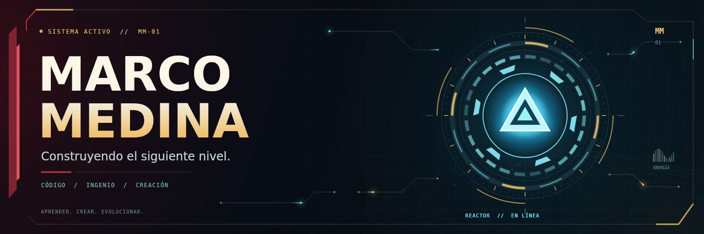

  

  <a href="#detrás-del-reactor">Sobre mí</a> · <a href="#proyectos">Proyectos</a> · <a href="./banner-reactor.png">Banner sin animación</a>

## Detrás del reactor

Soy **Marco Medina**. Bienvenido a mi laboratorio digital: un espacio para compartir proyectos, ideas y aprendizajes.

**Aprender. Crear. Evolucionar.**

<!-- Puedes añadir aquí tus estudios, intereses y tecnologías cuando quieras. -->

## Proyectos

Explora mis repositorios en la pestaña **Repositories** de este perfil.

<!-- Cuando tengas proyectos que quieras destacar, añade sus enlaces aquí. -->
<!-- También puedes añadir enlaces a tu portafolio y redes profesionales. -->
